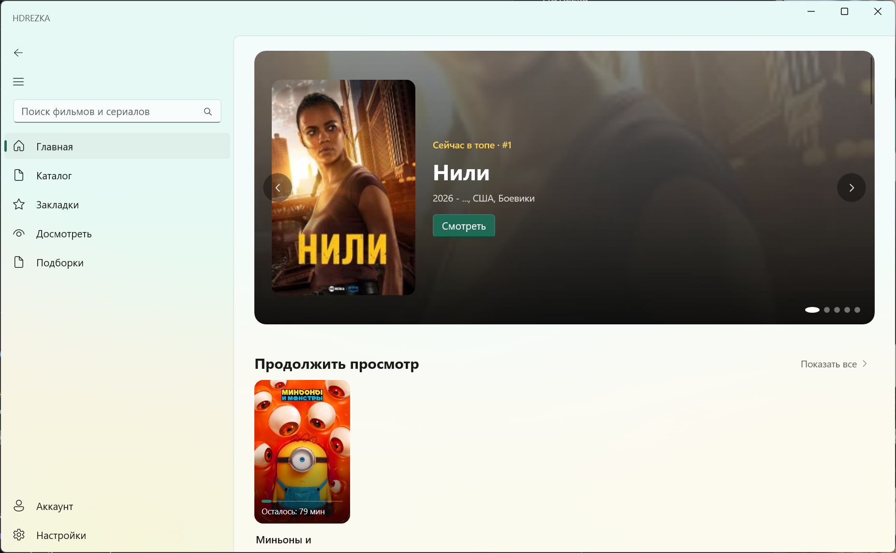
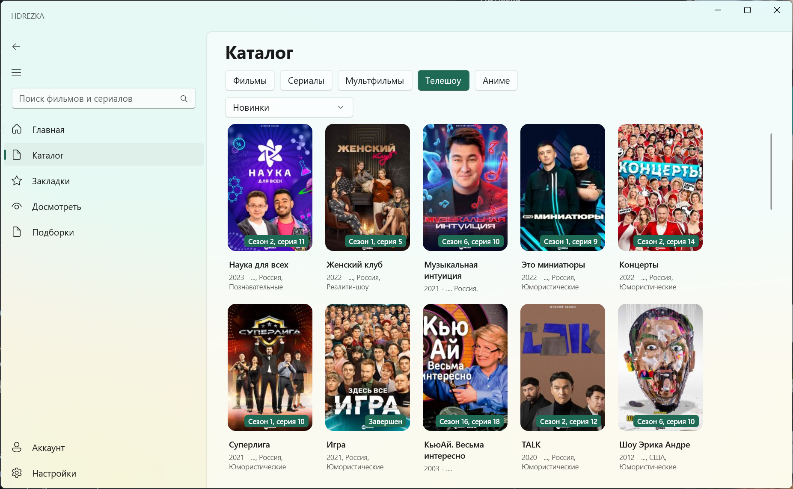
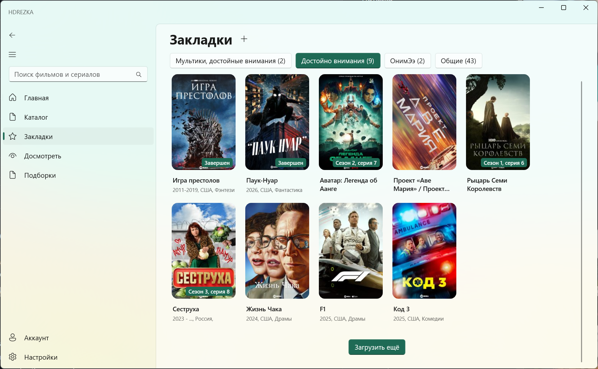
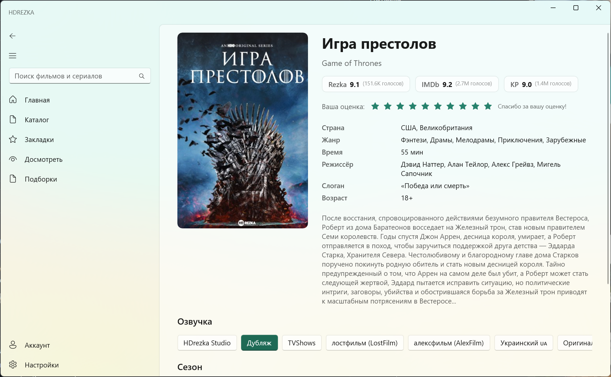
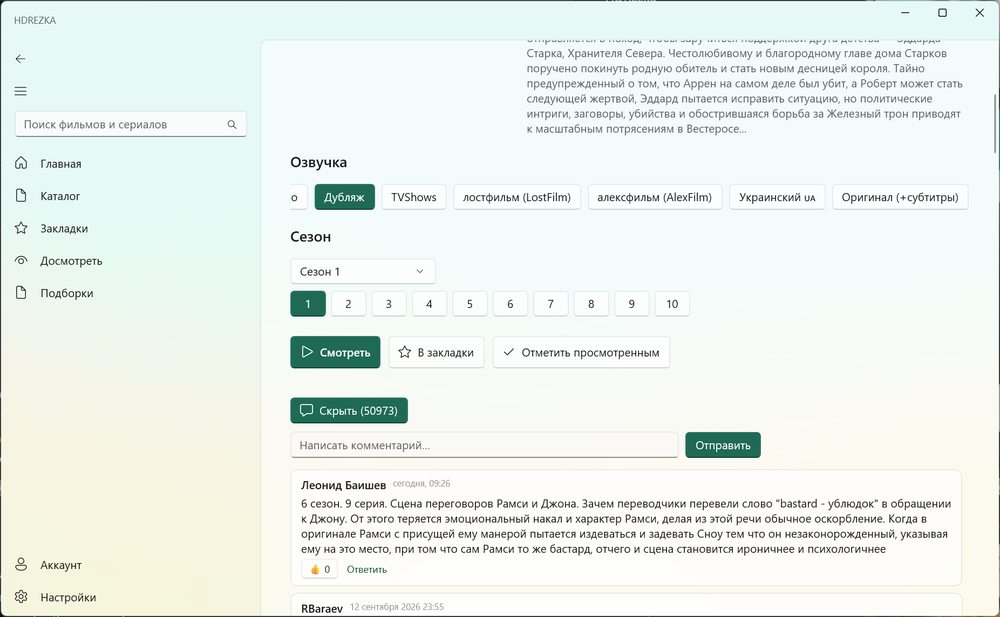
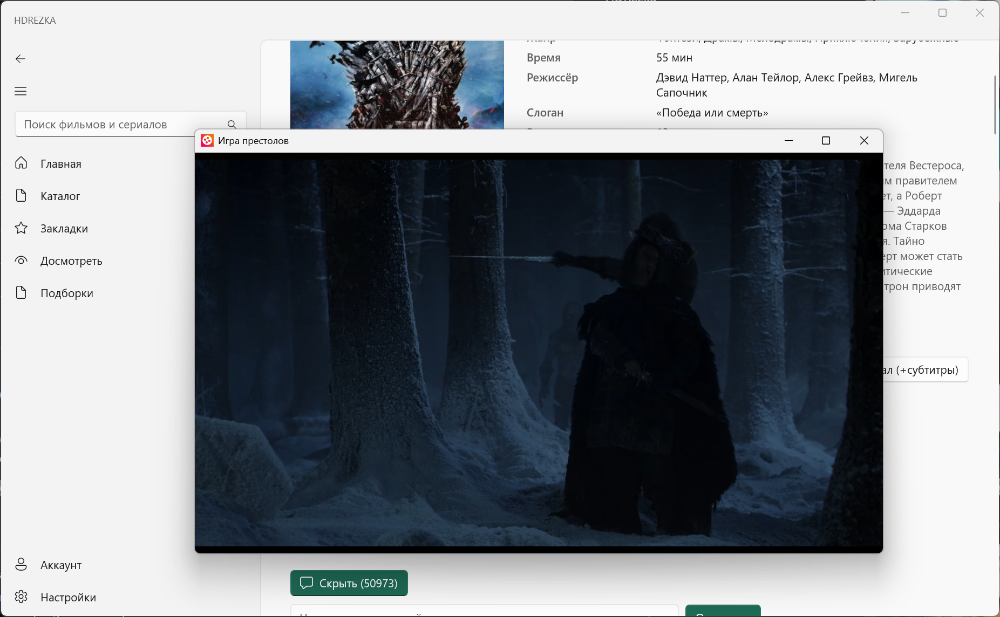
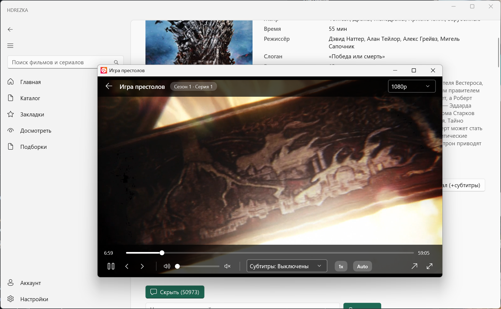

# HDREZKA for Windows

Неофициальный клиент HDRezka для Windows: каталог фильмов, сериалов, мультфильмов и аниме, онлайн-просмотр, закладки, история, комментарии и оценки.

   

## Контакты для связи:
- Группа в Telegram: https://t.me/hdrezkawin
- Threads: https://www.threads.com/@ados86rus?invite=0

## Возможности

- **Главная** — hero-карусель топа недели, подборки новинок, популярного и ожидаемого
- **Каталог** — фильмы, сериалы, мультфильмы, шоу и аниме с фильтрами и бесконечной прокруткой
- **Поиск** — по названию (от 2 символов)
- **Детали** — описания, рейтинги Rezka/IMDb/KP, озвучки с рейтингом, сезоны и серии, расписание выхода серий, трейлеры
- **Видеоплеер** — отдельное окно без системного тайтл-бара, сворачивается своей кнопкой, полноэкранный режим, качество, субтитры, скорость, zoom, автоперебор CDN-ссылок и качеств при ошибке воспроизведения, запоминание позиции, открытие во внешнем плеере, пин поверх окон, запрет сна ПК
- **Досмотреть** — локальная история + синхронизация с аккаунтом, удаление записей, ряд «Продолжить просмотр» на главной (умеет запускать сразу в плеер), сортировка новые/старые
- **Просмотрено** — отметки о просмотре для фильмов и серий, работают даже без аккаунта
- **Уведомления** — отслеживание сериалов (вручную колокольчиком или автоматически), тосты, вкладка с бейджем, ряд новинок на главной, расписание выхода серий с обратным отсчетом
- **Закладки** — категории сайта + создание и удаление своих категорий
- **Подборки** — коллекции сайта (по годам, жанрам, студиям)
- **Комментарии** — просмотр, ответы, лайки, отправка
- **Оценки** — голосование за фильмы и сериалы (1–10)
- **Аккаунт** — вход, профиль, выход
- **Персонализация** — тема (системная/светлая/тёмная), язык (русский/English/українська), размер постеров, блоки главной (порядок и видимость), зеркало сайта с автоматическим подбором (с учётом региона)

## Что нового в 1.8.1

- Починили воспроизведение видео: приложение запрашивало ссылку на поток не тем запросом — открывало HTML-страницу серии вместо API. Из-за этого плеер писал «Ошибка сети», хотя сайт работал. Теперь ссылки берутся правильным запросом.
- Если сайт ответил «ссылки нет» (устарел токен страницы), приложение само перечитывает страницу и пробует ещё раз.
- Плеер заранее проверяет сервер видео и сразу переходит к другой ссылке или качеству, а не висит 20 секунд. Если не отдаёт ни один сервер — понятный текст: «CDN не отдаёт файл, попробуйте VPN или другое зеркало».
- Проверка зеркал теперь открывает не только главную, но и реальную страницу фильма: раньше зеркало с рабочей главной и 403 на фильмах считалось лучшим.
- Добавлены понятные ошибки «сайт не выдал ссылку на видео» и «тайтл не найден».

## Что нового в 1.8.0

- **Безопасность.** Файл cookies шифруется через DPAPI — сессию нельзя унести с диска, просто скопировав JSON. Вход разрешён только через HTTPS-зеркало (по http пароль уходил бы открытым текстом), а скачанный установщик обновления проверяется по SHA-256 из релиза и по подписи Authenticode; если подтвердить не удалось — установка требует явного подтверждения.
- **Отмена и таймауты.** Зависшая загрузка прерывается после 2 минут без данных, запросы страниц отменяются при уходе со страницы, 404 больше не ретраится и показывает «тайтл не найден».
- **Сеть покрыта тестами.** Ретраи, переключение Android-заголовков на 403, редиректы и запрет https→http для логина проверяются на фейковом HTTP-обработчике (75 тестов вместо 37).
- **Производительность.** Главная кэшируется на 3 минуты (возврат назад не тянет 7 запросов), постеры декодируются в размер карточки (меньше памяти), комментарии-«простыня» в crash.log убрана.
- **Диагностика.** Информационные логи идут в `app.log` с уровнями, `crash.log` остаётся только для настоящих ошибок; утилиты (числовой id, даты «Досмотреть») вынесены в Core и покрыты тестами.

## Что нового в 1.7.0

- Плеер можно свернуть кнопкой в верхней панели (раньше окно не сворачивалось вообще).
- Починены зеркала: проверка зеркала теперь валидирует реальную разметку сайта, а не подстроку `wrapper`, отдаёт приоритет зеркалам региона пользователя и умеет автоматически переключаться при 403 (для незалогиненных).
- При ошибке воспроизведения плеер сам перебирает остальные CDN-ссылки и качества, прежде чем показать ошибку.
- Сезоны теперь загружаются для **выбранной** озвучки (у разных озвучек набора сезонов разный — например, у Coldfilm 2 сезона, у TVShows 1), а при открытии фильма восстанавливается последняя озвучка, сезон и серия из истории.
- Закладки можно убирать прямо со страницы фильма; просмотренное до конца отмечается как просмотренное.
- Настройки пишутся атомарно и не теряются при одновременных изменениях; кэш постеров не качает один файл дважды. рабочего

## Скриншоты

<details>
<summary>Показать скриншоты</summary>









</details>

## Системные требования

- Windows 10 версии 19041+ / Windows 11, x64
- Отдельная установка Windows App SDK **не требуется** (self-contained сборка)

## Установка

Вариант 1 — установщик: скачайте `HDREZKA-Setup-1.8.1.exe` из раздела [Releases](../../releases), запустите и укажите папку. Ярлыки появятся в меню «Пуск» (и на рабочем столе — опционально).

Вариант 2 — portable: скачайте `HDREZKA-1.8.1-portable-win-x64.zip`, распакуйте и запустите `HDREZKA.App.exe`. Настройки хранятся в `%AppData%/HDREZKA`.

## Частые вопросы

**Ошибка 403 / «Сайт ограничил доступ».** Зеркало не отвечает вашему региону или сети. Откройте «Настройки → Подобрать автоматически» — программа сама найдет рабочее зеркало. При повторных ошибках та же кнопка есть на экране ошибки и в диалоге входа.

**Ошибка сети в плеере на отдельных фильмах.** Ссылки на видео лежат на CDN за зеркалом, и конкретный CDN-узел может быть недоступен. Нажмите «Подобрать автоматически» прямо под ошибкой или выберите другое качество.

**ПК уходит в сон при просмотре.** Пока идет воспроизведение, программа запрещает сон. На паузе сон работает как обычно.

## Для разработчиков

```bash
dotnet build src/HDREZKA.App/HDREZKA.App.csproj   # сборка
dotnet test tests/HDREZKA.Tests/HDREZKA.Tests.csproj  # тесты
dotnet publish src/HDREZKA.App/HDREZKA.App.csproj -c Release  # папка для установщика
```

Требуется .NET 8 SDK (или новее). Установщик собирается скриптом `installer/installer.iss` через [Inno Setup 6](https://jrsoftware.org/isinfo.php). Структура: `src/HDREZKA.App` (WinUI 3: Views, Controls, Services), `src/HDREZKA.Core` (API-клиент и парсеры), `tests/HDREZKA.Tests`.

### Релиз

1. Обновите `<Version>` в `Directory.Build.props` и `MyAppVersion` в `installer/installer.iss`.
2. `dotnet publish src/HDREZKA.App/HDREZKA.App.csproj -c Release`, затем соберите установщик ISCC.
3. Положите рядом с установщиком `.sha256`:

```powershell
powershell -ExecutionPolicy Bypass -File installer/make-sha256.ps1
```

Приложение при автообновлении сверяет скачанный установщик с этим файлом и с Authenticode-подписью. Если ни того, ни другого нет, установка спросит подтверждение. Подписанный установщик (signtool) проходит проверку без вопросов.

## Дисклеймер

Неофициальный клиент. Приложение не хранит и не распространяет контент, а лишь предоставляет доступ к общедоступным данным сайта. Используйте на свой страх и риск.

## Донаты

Если приложение полезно — поддержите разработку:

- Крипта в TON (любые токены сети TON):
  ```
  UQBNd1gXEZi4oahqNeJEy18KCUXfVvmBnPgXlokPpzU_PbFQ
  ```
- Подписка на Boosty: https://boosty.to/eddinwork/donate

QR-коды — в разделе «Настройки → Поддержать проект».

## Благодарности

Проект — порт macOS-клиента [HDrezka for macOS](https://github.com/voidboost/hdrezka-swiftui) (MIT License, © 2025 voidboost). Парсинг сайта, работа с API и алгоритм дешифрования ссылок на поток основаны на нём.

## Лицензия

MIT License, Copyright (c) 2026. Текст на русском, английском и украинском — в [LICENSE.md](LICENSE.md).
